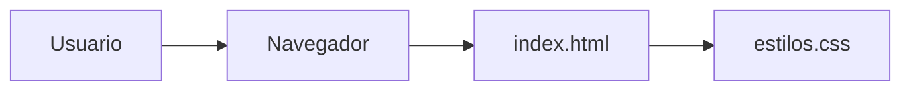
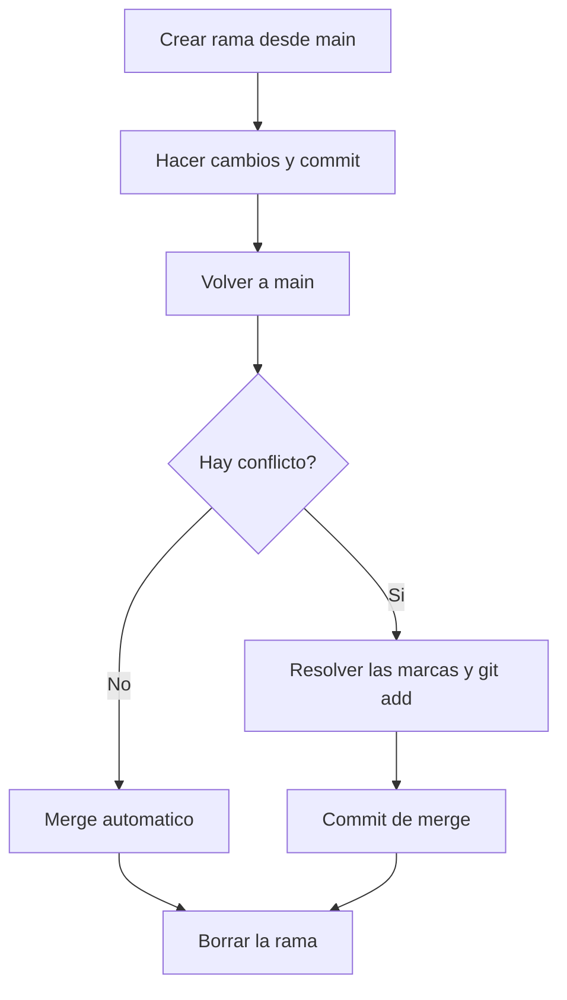

# Lab 02 - Ramas, Merge y Conflictos


Página web mínima en HTML y CSS creada para practicar ramas, merge, resolución de conflictos y etiquetas con Git.
Pensada para estudiantes que empiezan con Git y quieren ver, en un proyecto pequeño, cómo se separan y se unen las ramas.

## Tabla de contenidos

- [Instalacion](#instalacion)
- [Uso](#uso)
- [Estructura del proyecto](#estructura-del-proyecto)
- [Historial de ramas](#historial-de-ramas)
- [Hoja de ruta](#hoja-de-ruta)
- [Ejemplos de codigo](#ejemplos-de-codigo)
- [Arquitectura](#arquitectura)
- [Contribucion](#contribucion)
- [Licencia](#licencia)
- [Autor](#autor)

## Instalacion

Solo necesitas Git y un navegador web. No hay que instalar dependencias.

```bash
git clone https://github.com/Joan322-cloud/lab02-ramas.git
cd lab02-ramas
code .
```

## Uso

1. Abrir `index.html` con doble clic para ver la página en el navegador.
2. Revisar el título en azul institucional, el menú de navegación y el pie de página.
3. Ver el dibujo del historial de ramas con este comando:

```bash
git log --oneline --graph --all
```

4. Ver la versión estable marcada con `git tag`.

## Estructura del proyecto

| Archivo | Para qué sirve | Líneas |
| :--- | :--- | ---: |
| index.html | Título, menú de navegación y pie de página | 20 |
| estilos.css | Tipografía, márgenes y color del título | 8 |
| README.md | Esta documentación | - |
| CONTRIBUTING.md | Reglas para colaborar en el proyecto | - |
| LICENSE | Licencia MIT del proyecto | - |

## Historial de ramas

| Rama | Qué cambió | Tipo de merge | Estado |
| :--- | :--- | :---: | ---: |
| menu | Agrega el menú de navegación | Fast-forward | Fusionada |
| color-azul | Cambia el color del título a azul | Fast-forward | Fusionada |
| color-rojo | Cambia el mismo color a rojo | Con conflicto | Fusionada |
| pie-pagina | Agrega el pie de página | Fast-forward | Fusionada |

El conflicto entre `color-azul` y `color-rojo` se resolvió con una tercera opción: el azul institucional `#0072ce`. La versión estable quedó marcada con la etiqueta `v1.0`.

## Hoja de ruta

- [x] Estructura inicial con index.html y estilos.css
- [x] Menú de navegación (rama menu)
- [x] Conflicto de color resuelto con un commit de merge
- [x] Etiqueta v1.0 publicada en GitHub
- [x] Pie de página (rama pie-pagina)
- [x] README profesional y guía de contribución
- [ ] Cambiar el idioma de la página a español (`lang="es"`) y el título de la pestaña
- [ ] Enlaces reales en el menú
- [ ] Diseño adaptable a celular

## Ejemplos de codigo

Menú y pie de página dentro de `index.html`:

```html
<nav>
    <a href="#">Inicio</a>
    <a href="#">Cursos</a>
    <a href="#">Contacto</a>
</nav>
<footer>
    <p>Laboratorio 02 - Joan Sebastian Maury Vargas - TECSUP</p>
</footer>
```

Color del título después de resolver el conflicto, en `estilos.css`:

```css
h1 {
    color: #0072ce;
}
```

## Arquitectura



### Flujo de trabajo con ramas



## Contribucion

Lee la [guia de contribucion](CONTRIBUTING.md) antes de enviar cambios.

1. Haz un fork del repositorio.
2. Crea una rama: `git checkout -b mejora/mi-cambio`
3. Guarda tus cambios: `git commit -m "Describe tu cambio"`
4. Sube la rama: `git push origin mejora/mi-cambio`
5. Abre un Pull Request explicando qué mejoraste.

## Licencia

Este proyecto usa la licencia MIT. Revisa el archivo [LICENSE](LICENSE).

## Autor

Hecho por **Joan Sebastian Maury Vargas** - [GitHub](https://github.com/Joan322-cloud)